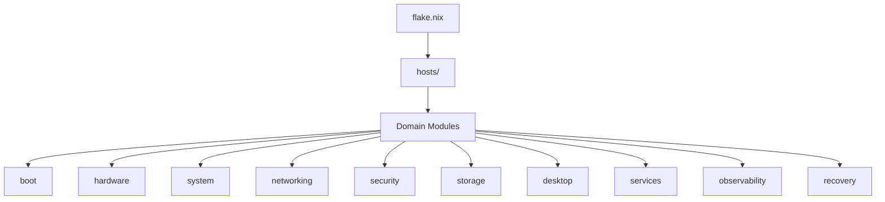
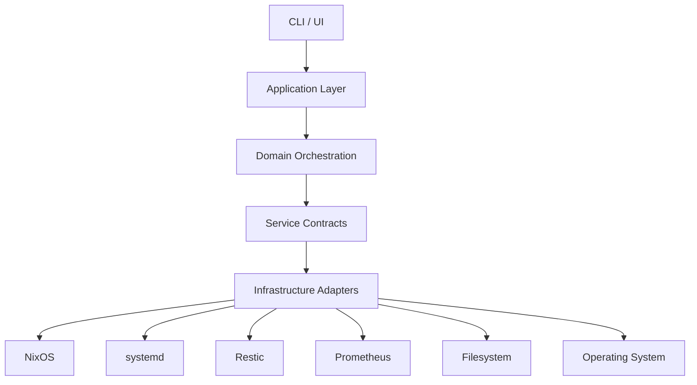

# Architecture

> **Complete architectural reference for the ivali NixOS infrastructure.**
>
> This document defines the system's domains, ownership boundaries, dependency
> rules, runtime service contracts, state ownership, filesystem ownership,
> security boundaries, observability model, recovery model, architecture
> enforcement, and migration strategy.
>
> `ARCHITECTURE.md` is the architectural authority for this repository.
> Machine-enforceable architectural rules are represented in
> `architecture/` and enforced by architecture tests, the architecture
> linter, CI, and the `ivali` verification workflow.

---

# Table of Contents

1. [Purpose](#purpose)
2. [Architectural Principles](#architectural-principles)
3. [Architectural Authority](#architectural-authority)
4. [System Context](#system-context)
5. [Domain Model](#domain-model)
6. [Domain Responsibilities](#domain-responsibilities)
7. [Domain Boundary Rules](#domain-boundary-rules)
8. [Host Composition](#host-composition)
9. [NixOS Architecture](#nixos-architecture)
10. [Runtime Architecture](#runtime-architecture)
11. [Service Contracts](#service-contracts)
12. [Dependency Architecture](#dependency-architecture)
13. [State Ownership](#state-ownership)
14. [Filesystem Ownership](#filesystem-ownership)
15. [Configuration Ownership](#configuration-ownership)
16. [Secret Ownership](#secret-ownership)
17. [Network and Port Ownership](#network-and-port-ownership)
18. [Process and Systemd Ownership](#process-and-systemd-ownership)
19. [Observability Architecture](#observability-architecture)
20. [Security Architecture](#security-architecture)
21. [Deployment and GitOps Architecture](#deployment-and-gitops-architecture)
22. [Recovery and Rollback Architecture](#recovery-and-rollback-architecture)
23. [Testing and Architecture Fitness](#testing-and-architecture-fitness)
24. [Architecture Enforcement](#architecture-enforcement)
25. [Architecture Exceptions](#architecture-exceptions)
26. [Migration Strategy](#migration-strategy)
27. [Adding a New Domain](#adding-a-new-domain)
28. [Adding a New Service](#adding-a-new-service)
29. [AI Agent Architecture Contract](#ai-agent-architecture-contract)
30. [Definition of Architectural Done](#definition-of-architectural-done)
31. [Final Target Architecture](#final-target-architecture)

---

# 1. Purpose

The ivali infrastructure is a **domain-oriented, declarative, test-driven,
GitOps-managed NixOS platform**.

The architecture exists to prevent the repository from becoming a collection
of unrelated Nix modules, shell scripts, Go packages, services, and automation
that happen to work together.

The architecture must provide:

* clear ownership;
* explicit boundaries;
* controlled dependencies;
* predictable composition;
* reproducibility;
* testability;
* observability;
* security isolation;
* recoverability;
* operational clarity;
* low coupling;
* minimal duplication;
* safe AI-assisted development.

The architecture is not merely documentation.

**Architectural rules must be executable wherever practical.**

If a rule can be expressed as a test, linter rule, schema, or CI gate, it
should not rely solely on human memory.

---

# 2. Architectural Principles

## 2.1 Domain ownership

Every significant capability has one authoritative owner.

There must be:

> **One capability → one owner → one source of truth.**

Multiple consumers are allowed.

Multiple competing implementations are not.

---

## 2.2 Explicit boundaries

Domains communicate through explicitly defined contracts.

A domain must not reach into another domain's:

* internal implementation;
* private state;
* filesystem state;
* configuration;
* service process;
* database;
* runtime cache;
* lock;
* secret material;

unless the access is explicitly permitted by architecture policy.

---

## 2.3 Dependency direction

Dependencies must point toward stable abstractions and ownership boundaries.

High-level orchestration may depend on service contracts.

Low-level infrastructure implementations must not become accidental
orchestration layers.

---

## 2.4 Declarative infrastructure

NixOS configuration is declarative.

Imperative scripts may exist where operationally necessary, but they must
not become a second configuration system.

Configuration belongs in Nix.

Operational behavior belongs in services, commands, or scripts.

Persistent secrets belong in SOPS/age.

---

## 2.5 Test-driven development

Behavior-changing implementation follows:

```text
DEFINE BEHAVIOR
      │
      ▼
WRITE TEST
      │
      ▼
RUN TEST
      │
      ▼
PROVE RED
      │
      ▼
IMPLEMENT MINIMUM CODE
      │
      ▼
PROVE GREEN
      │
      ▼
REFACTOR
      │
      ▼
ARCHITECTURE / INTEGRATION TESTS
```

Architecture changes are also expected to be test-driven where practical.

A new boundary should normally have a corresponding architecture test,
fixture, schema rule, or linter rule.

---

## 2.6 Reproducibility

The same declared configuration should produce the same intended system
behavior regardless of which AI agent, developer, or CI runner performs the
change.

---

## 2.7 Observability

A production capability is incomplete if it cannot be diagnosed.

Important services must expose appropriate:

* health;
* status;
* metrics;
* logs;
* failure information;
* recovery information.

---

## 2.8 Security by boundary

Security is not an afterthought applied after implementation.

Every domain must have an explicit security boundary.

The architecture must minimize:

* privilege;
* secret exposure;
* network exposure;
* filesystem access;
* cross-domain trust;
* mutable state.

---

## 2.9 Recovery as architecture

Deployment, rollback, backup, health validation, and recovery are part of
the architecture.

A service that can be deployed but cannot be safely diagnosed or recovered
is architecturally incomplete.

---

# 3. Architectural Authority

The following hierarchy determines which source is authoritative when
information conflicts.

```text
Actual repository state
        │
        ▼
Executable tests
        │
        ▼
Architecture manifests / schemas
        │
        ▼
Architecture linter
        │
        ▼
CI enforcement
        │
        ▼
Implementation
        │
        ▼
Architecture documentation
        │
        ▼
CONTEXT_HANDOFF.md
        │
        ▼
Previous AI assumptions
```

AI-generated assumptions are never architectural authority.

The current repository is the source of truth.

---

# 4. System Context

The system consists of several architectural layers.

```text
┌──────────────────────────────────────────────────────────────┐
│                         USER / OPERATOR                      │
└──────────────────────────────┬───────────────────────────────┘
                               │
                               ▼
┌──────────────────────────────────────────────────────────────┐
│                         IVALI CLI / UI                       │
│             Control plane and operator interface             │
└──────────────────────────────┬───────────────────────────────┘
                               │
                               ▼
┌──────────────────────────────────────────────────────────────┐
│                    APPLICATION SERVICES                      │
│       GitOps / Health / Backup / Platform / Metrics          │
└──────────────────────────────┬───────────────────────────────┘
                               │
                ┌──────────────┼───────────────┐
                ▼              ▼               ▼
         ┌────────────┐ ┌────────────┐ ┌──────────────┐
         │ NixOS      │ │ Observ-    │ │ Security /  │
         │ Platform   │ │ ability    │ │ Networking   │
         └────────────┘ └────────────┘ └──────────────┘
                │              │               │
                └──────────────┼───────────────┘
                               ▼
┌──────────────────────────────────────────────────────────────┐
│                    HOST / HARDWARE LAYER                     │
│                  prague / tuscany / others                   │
└──────────────────────────────────────────────────────────────┘
```

The control plane does not own every underlying subsystem.

It orchestrates capabilities through contracts.

---

# 5. Domain Model

The repository is organized into architectural domains.

The exact physical directory layout is authoritative from the repository
itself; this document describes ownership rather than imposing historical
directory names.

Core domains include:

| Domain           | Primary responsibility                                 |
| ---------------- | ------------------------------------------------------ |
| `boot`           | Bootloader, kernel, initrd, boot-time behavior         |
| `hardware`       | Hardware-specific configuration and drivers            |
| `hosts`          | Host composition and host-specific declarations        |
| `system`         | Base operating-system configuration                    |
| `storage`        | Filesystems, mounts, storage policy                    |
| `networking`     | Network interfaces, routing, DNS, firewall integration |
| `security`       | Security policy, hardening, access control             |
| `ssh`            | SSH server/client policy and access                    |
| `desktop`        | Desktop environment and graphical integration          |
| `home`           | Home Manager/user environment                          |
| `developer`      | Development environment and tooling                    |
| `packages`       | Package declarations and package composition           |
| `services`       | System/application service configuration               |
| `observability`  | Metrics, logs, monitoring and diagnostics              |
| `recovery`       | Backup, rollback, recovery and resilience              |
| `automation`     | Scheduled/automated operational tasks                  |
| `virtualization` | Virtualization-related infrastructure                  |
| `internal`       | Go control-plane implementation                        |
| `architecture`   | Machine-readable architectural policy                  |
| `ci`             | CI/CD configuration and verification                   |
| `scripts`        | Controlled operational scripts                         |

The list is descriptive.

The repository's actual domain manifest is authoritative.

---

# 6. Domain Responsibilities

## 6.1 `hosts`

Hosts are composition roots.

A host may:

* select modules;
* define host-specific hardware;
* define host-specific values;
* enable capabilities;
* compose domains.

A host must not contain reusable implementation that belongs to a domain.

### Rule

```text
HOST = COMPOSITION

HOST ≠ DOMAIN IMPLEMENTATION
```

---

## 6.2 `boot`

Owns:

* bootloader configuration;
* kernel configuration;
* initrd;
* early boot modules;
* boot-time security configuration.

It must not own application services.

---

## 6.3 `hardware`

Owns hardware-specific behavior.

Examples:

* GPU;
* audio hardware;
* Bluetooth hardware;
* laptop-specific devices;
* hardware drivers.

Hardware quirks must remain isolated from general platform policy whenever
possible.

---

## 6.4 `networking`

Owns:

* NetworkManager;
* interfaces;
* DNS;
* routing;
* firewall integration;
* Tailscale integration;
* network policy.

Networking must not contain application-level business logic.

---

## 6.5 `security`

Owns:

* hardening;
* access control;
* authentication policy;
* authorization policy;
* firewall policy;
* sandboxing;
* AppArmor;
* security services;
* secret-management integration.

Security policy must not be duplicated in individual application domains.

---

## 6.6 `desktop`

Owns graphical-session configuration.

Examples:

* GNOME/KDE;
* display manager;
* portals;
* graphical services;
* desktop integrations;
* session-level audio/video integration where appropriate.

Desktop configuration must remain separate from core headless platform
services.

---

## 6.7 `observability`

Owns:

* metrics;
* logging;
* dashboards;
* health visibility;
* alerting infrastructure;
* telemetry configuration.

Observability observes other domains.

It must not become the owner of their state.

---

## 6.8 `recovery`

Owns:

* backups;
* snapshots;
* rollback support;
* disaster recovery;
* recovery verification.

Recovery must remain independent enough to function when the primary
application layer is degraded.

---

## 6.9 `internal`

`internal/` contains the Go control plane.

It should expose capabilities through stable interfaces rather than allowing
callers to depend on implementation details.

---

# 7. Domain Boundary Rules

The following rules are mandatory.

## Rule 1 — No hidden cross-domain state access

Forbidden:

```text
Domain A → reads Domain B's private state
```

Allowed:

```text
Domain A → Domain B contract → Domain B state
```

---

## Rule 2 — No duplicated ownership

Forbidden:

```text
GitOps owns deployment state
Automation also owns deployment state
Script also owns deployment state
```

Required:

```text
GitOps owns deployment state
Consumers query GitOps
```

---

## Rule 3 — No configuration shadowing

A capability must not have competing configuration sources.

For example, if a port is declared in Nix, Go should not silently redefine it.

---

## Rule 4 — No implementation leakage

Consumers must not depend on concrete implementations when a service
contract exists.

---

## Rule 5 — No circular domain dependencies

The architecture must remain a directed acyclic dependency graph unless a
documented exception explicitly permits otherwise.

---

## Rule 6 — Exceptions are explicit

Every intentional violation must exist in:

```text
architecture/exceptions.yaml
```

No undocumented architectural violation is acceptable.

---

# 8. Host Composition

Hosts are composition roots.

Conceptually:

```text
flake
  │
  ▼
host
  │
  ├── boot
  ├── hardware
  ├── system
  ├── networking
  ├── security
  ├── storage
  ├── services
  ├── observability
  ├── recovery
  └── desktop
```

The host selects and composes capabilities.

It should not implement those capabilities.

### Host rule

```text
Hosts may depend on domains.

Domains must not depend on individual hosts.
```

Host-specific behavior should be represented through:

* host modules;
* options;
* typed configuration;
* explicit hardware declarations.

---

# 9. NixOS Architecture

The Nix layer is responsible for declarative system composition.

Conceptually:

```text
flake.nix
    │
    ▼
flake outputs
    │
    ▼
host composition
    │
    ▼
domain modules
    │
    ├── options
    ├── services
    ├── packages
    ├── systemd
    ├── security
    └── filesystem/network configuration
```

## Nix rules

Nix modules must:

* expose explicit options;
* use typed options where appropriate;
* avoid hidden mutable state;
* avoid imperative configuration;
* avoid duplicate service definitions;
* avoid hardcoded secrets;
* avoid unnecessary host coupling;
* remain composable.

---

# 10. Runtime Architecture

The Go control plane provides operational capabilities.

The intended structure is:

```text
CLI / UI
   │
   ▼
Application / command layer
   │
   ▼
Domain orchestration
   │
   ▼
Service interfaces
   │
   ▼
Concrete infrastructure adapters
   │
   ├── systemd
   ├── NixOS
   ├── restic
   ├── Prometheus
   ├── filesystem
   └── operating system
```

Concrete infrastructure implementations should not leak into unrelated
domains.

---

# 11. Service Contracts

Service contracts define stable runtime boundaries.

Contracts should live in the appropriate service abstraction layer.

They should describe:

* behavior;
* inputs;
* outputs;
* failure semantics;
* ownership;
* observability;
* security requirements.

---

## 11.1 NotificationService

### Purpose

Centralized notification delivery.

### Contract

```go
type NotificationService interface {
    SendAlert(
        ctx context.Context,
        severity Severity,
        title string,
        message string,
    ) error

    SendDeploymentResult(
        ctx context.Context,
        result DeploymentResult,
    ) error

    SendHealthAlert(
        ctx context.Context,
        component string,
        healthy bool,
        details string,
    ) error
}
```

### Owner

Notification infrastructure.

### Consumers

* GitOps;
* observability;
* backup;
* platform;
* recovery.

Notification consumers must not implement their own competing notification
transport unless explicitly approved.

---

# 11.2 BackupService

### Purpose

Abstract backup operations.

### Contract

```go
type BackupService interface {
    Trigger(ctx context.Context) error

    Status(ctx context.Context) (*BackupStatus, error)

    ListSnapshots(
        ctx context.Context,
        limit int,
    ) ([]Snapshot, error)

    LastSnapshot(
        ctx context.Context,
    ) (*Snapshot, error)

    LastRun(
        ctx context.Context,
    ) (time.Time, error)
}
```

### Owner

Recovery / backup domain.

### Rule

Consumers must not directly manipulate the restic repository.

---

# 11.3 MetricsProvider

### Purpose

Provide observability data without exposing backend-specific implementation
details to consumers.

### Contract

```go
type MetricsProvider interface {
    Query(
        ctx context.Context,
        promQL string,
    ) (float64, error)

    ServiceStatuses(
        ctx context.Context,
    ) (map[string]ServiceHealth, error)

    SystemMetrics(
        ctx context.Context,
    ) (*SystemMetrics, error)
}
```

### Owner

Observability.

### Consumers

* dashboard;
* platform;
* health;
* operational UI.

---

# 11.4 HealthChecker

### Purpose

Provide a unified health model.

### Contract

```go
type HealthChecker interface {
    CheckSystem(
        ctx context.Context,
    ) (*SystemHealth, error)

    CheckServices(
        ctx context.Context,
        services []string,
    ) (map[string]ServiceHealth, error)

    CheckNetwork(
        ctx context.Context,
    ) (*NetworkHealth, error)

    CheckDisk(
        ctx context.Context,
        mounts []string,
    ) (map[string]DiskHealth, error)
}
```

### Owner

Platform health domain.

Health checking should aggregate information rather than duplicate the
implementation of every underlying subsystem.

---

# 11.5 PlatformService

### Purpose

Expose platform-level operations.

### Contract

```go
type PlatformService interface {
    Health(
        ctx context.Context,
    ) (*PlatformHealth, error)

    Status(
        ctx context.Context,
    ) (*PlatformStatus, error)

    Doctor(
        ctx context.Context,
    ) (*DiagnosticReport, error)

    Rebuild(
        ctx context.Context,
        host string,
    ) (string, error)

    Rollback(
        ctx context.Context,
    ) (string, error)
}
```

### Owner

Platform control plane.

### Rule

PlatformService may orchestrate platform operations, but must not become a
miscellaneous dumping ground for unrelated capabilities.

---

# 12. Dependency Architecture

## 12.1 Nix dependency direction



The exact graph is generated from the repository's actual module imports and
architecture manifest.

---

## 12.2 Runtime dependency direction



---

## 12.3 Forbidden dependency patterns

The following are architectural smells or violations:

```text
domain → another domain's private implementation
domain → another domain's private filesystem
domain → arbitrary shell implementation
UI → systemd directly
UI → restic directly
GitOps → backup internals
health → deployment internals
observability → ownership of application state
```

Preferred:

```text
UI
 │
 ▼
Service Contract
 │
 ▼
Infrastructure Adapter
```

---

# 13. State Ownership

Each significant piece of persistent state has one owner.

| State                      | Owner                      | Access                    |
| -------------------------- | -------------------------- | ------------------------- |
| GitOps state               | GitOps                     | GitOps contract           |
| Deployment state           | GitOps / deployment domain | deployment contract       |
| Backup repository metadata | Recovery                   | BackupService             |
| Metrics state              | Observability              | MetricsProvider           |
| Health cache               | Health/Observability       | Health contract           |
| Security policy            | Security                   | Security configuration    |
| Host configuration         | Nix/Host composition       | Nix evaluation            |
| User environment           | Home Manager               | declarative configuration |

The exact paths must be synchronized with the repository's machine-readable
architecture manifest.

---

# 14. Filesystem Ownership

Filesystem paths are architectural resources.

| Path                        | Owner                | Access policy                      |
| --------------------------- | -------------------- | ---------------------------------- |
| `/var/lib/gitops/`          | GitOps               | Owner only; consumers use contract |
| `/var/lib/observability/`   | Observability        | Owner only                         |
| `/var/lib/health-endpoint/` | Health/Observability | Contract-mediated                  |
| `/mnt/backup/`              | Recovery             | Owner only                         |
| `/run/deploy.lock`          | Deployment/GitOps    | Controlled synchronization access  |
| `/run/secrets/`             | Secret management    | Explicit read-only consumers       |

The following pattern is forbidden:

```text
Service A
    │
    └── directly opens Service B's state directory
```

Instead:

```text
Service A
    │
    ▼
Service B API / contract
    │
    ▼
Service B state
```

---

# 15. Configuration Ownership

Configuration must have a single authoritative source.

For each configurable resource, identify:

```text
Owner
Source of truth
Consumers
Runtime representation
Override policy
```

Example:

```text
Prometheus endpoint
        │
        ▼
Nix configuration
        │
        ▼
Generated runtime configuration
        │
        ▼
MetricsProvider
```

Do not maintain:

```text
Nix port = 9090
Go port = 9091
Shell script port = 9090
```

Configuration drift is an architectural defect.

---

# 16. Secret Ownership

Secrets are never architecture-neutral configuration.

Secrets must be managed through:

```text
SOPS
  │
  ▼
age-encrypted data
  │
  ▼
authorized runtime consumer
```

Forbidden:

* plaintext secrets in Git;
* secrets embedded in Nix expressions;
* secrets embedded in Go;
* secrets in shell scripts;
* secrets in logs;
* secrets in architecture manifests;
* secrets passed unnecessarily across domain boundaries.

Secret consumers should receive only the minimum secret material required.

---

# 17. Network and Port Ownership

Every listening service must have an identified owner.

For every port:

```text
Port
Owner
Protocol
Bind address
Purpose
Firewall policy
Authentication requirement
Exposure scope
```

A port must not be independently configured by multiple domains.

Example:

```text
Prometheus
   │
   ├── Owner: Observability
   ├── Bind: explicit
   ├── Firewall: Security
   └── Consumer: MetricsProvider
```

Firewall policy remains owned by the security/networking architecture rather
than being duplicated in individual applications.

---

# 18. Process and Systemd Ownership

Every persistent process must have a defined owner.

Ownership includes:

* service definition;
* startup policy;
* restart policy;
* dependencies;
* resource limits;
* filesystem permissions;
* sandboxing;
* logs;
* health checks;
* shutdown behavior.

A domain must not create hidden unmanaged daemons.

Prefer declarative systemd units generated by Nix.

---

# 19. Observability Architecture

Observability is cross-cutting infrastructure, not ownership of the systems
it observes.

Conceptually:

```text
                  ┌───────────────┐
                  │ Observability │
                  └───────┬───────┘
                          │
          ┌───────────────┼────────────────┐
          ▼               ▼                ▼
       Metrics           Logs            Health
          │               │                │
          └───────────────┼────────────────┘
                          ▼
                    Operator / UI
```

Observability should provide:

* metrics;
* logs;
* service health;
* deployment health;
* alerts;
* diagnostics;
* historical visibility.

Observability must not mutate another domain's state merely to obtain
visibility.

---

# 20. Security Architecture

Security controls exist at multiple layers.

```text
┌─────────────────────────────┐
│ Identity / Authentication   │
├─────────────────────────────┤
│ Authorization               │
├─────────────────────────────┤
│ Network / Firewall          │
├─────────────────────────────┤
│ Process Isolation           │
├─────────────────────────────┤
│ Filesystem Permissions      │
├─────────────────────────────┤
│ Secrets / Encryption        │
├─────────────────────────────┤
│ NixOS Hardening             │
└─────────────────────────────┘
```

Security must be:

* least privilege;
* explicit;
* auditable;
* reproducible;
* testable.

Security architecture violations are hard failures unless explicitly
documented as temporary exceptions.

---

# 21. Deployment and GitOps Architecture

Deployment follows:

```text
Change
  │
  ▼
TDD
  │
  ▼
Local Verification
  │
  ▼
ivali flow
  │
  ▼
Feature Branch
  │
  ▼
Merge Request
  │
  ▼
CI Gates
  │
  ▼
Approved Merge
  │
  ▼
GitOps Reconciliation
  │
  ▼
Generation Switch
  │
  ▼
Health Validation
  │
  ├── PASS → deployment accepted
  │
  └── FAIL → rollback / recovery
```

Git operations are governed by `IVALi_FLOW.md`.

AI agents must not bypass that workflow.

---

# 22. Recovery and Rollback Architecture

Every deployment-capable system should have a recovery path.

The architecture recognizes:

```text
Deployment
    │
    ▼
Validation
    │
    ├── healthy ──────► accepted
    │
    └── unhealthy
            │
            ▼
        diagnosis
            │
       ┌────┴────┐
       ▼         ▼
    retry      rollback
       │         │
       └────┬────┘
            ▼
       health check
```

Recovery must be:

* observable;
* deterministic;
* tested;
* documented;
* safe to invoke.

Backups are not considered valid merely because backup commands succeed.

Recovery capability must be periodically validated where practical.

---

# 23. Testing and Architecture Fitness

Architecture must be tested at multiple levels.

## 23.1 Unit tests

Verify individual service behavior.

---

## 23.2 Integration tests

Verify service boundaries and infrastructure adapters.

---

## 23.3 Architecture tests

Verify:

* allowed dependencies;
* forbidden dependencies;
* domain ownership;
* service contracts;
* exception policy;
* filesystem ownership;
* configuration ownership.

---

## 23.4 End-to-end tests

Where practical, verify real workflows:

```text
configuration
    ↓
deployment
    ↓
service startup
    ↓
health
    ↓
observability
    ↓
notification
    ↓
recovery
```

---

## 23.5 TDD architecture rule

For a new architectural constraint:

```text
1. Define violation
2. Write architecture test
3. Run test
4. Confirm RED
5. Implement architecture rule
6. Confirm GREEN
7. Refactor implementation
8. Run complete architecture suite
```

Architecture policy must not be weakened merely to make CI pass.

---

# 24. Architecture Enforcement

Machine-readable architectural policy lives under:

```text
architecture/
```

Expected policy artifacts include:

```text
architecture/
├── dependencies.yaml
├── domains.yaml
└── exceptions.yaml
```

The exact files are authoritative from the repository.

---

## 24.1 Domain manifest

The domain manifest should describe:

```yaml
domain:
  owner:
  paths:
  responsibilities:
  allowed_dependencies:
  forbidden_dependencies:
  state_paths:
  configuration:
  services:
```

---

## 24.2 Dependency manifest

Dependency policy should describe:

```yaml
source:
target:
type:
allowed:
reason:
```

---

## 24.3 Exception manifest

Exceptions must contain:

```yaml
id:
source:
target:
reason:
owner:
created:
review:
status:
removal_plan:
```

Exceptions are temporary architectural debt unless explicitly classified as
permanent.

---

## 24.4 Architecture linter

The architecture linter should detect at minimum:

* forbidden imports;
* forbidden filesystem access;
* undeclared domains;
* undeclared dependencies;
* duplicate ownership;
* dependency cycles;
* expired exceptions;
* undocumented cross-domain access;
* service contract violations where statically detectable.

Architecture violations should fail CI unless explicitly permitted.

---

# 25. Architecture Exceptions

Exceptions exist for legitimate technical constraints.

They are not a mechanism for bypassing architecture.

Every exception requires:

* unique ID;
* source domain;
* target domain;
* reason;
* owner;
* creation date;
* review date;
* remediation plan;
* current status.

Example:

```yaml
- id: EXC-001
  source: gitops
  target: networking
  reason: temporary bootstrapping dependency
  owner: Willis Ivali
  created: 2026-09-17
  review: 2026-10-17
  status: active
  removal_plan: migrate to NetworkService
```

Expired exceptions must fail architecture verification.

---

# 26. Migration Strategy

Architectural migration is incremental.

A migration must not introduce a second competing architecture indefinitely.

---

## Phase 0 — Discover

Before modifying architecture:

```text
inventory
   ↓
dependencies
   ↓
runtime behavior
   ↓
state ownership
   ↓
configuration ownership
   ↓
security boundaries
```

The actual repository is inspected before assumptions are made.

---

# Phase 1 — Establish Contracts

Define service interfaces before replacing implementations.

Required behavior:

```text
test
 ↓
interface
 ↓
implementation
 ↓
consumer migration
```

---

# Phase 2 — Migrate Consumers

Move consumers from direct infrastructure access to service contracts.

Example:

### Before

```go
output := c.svc.Nix.Rebuild("")
```

### After

```go
output, err := c.registry.Platform.Rebuild(ctx, host)
```

The exact implementation must follow the repository's actual service
registry and package structure.

---

# Phase 3 — Remove Duplicate Implementations

Once all consumers use the new implementation:

1. prove consumers are migrated;
2. prove integration tests pass;
3. remove the old implementation;
4. run architecture tests;
5. run complete verification.

Do not maintain two permanent implementations.

---

# Phase 4 — Consolidate Operational Scripts

Scripts that contain reusable domain logic should gradually move toward
the appropriate service or declarative configuration.

A script may remain when it provides a genuinely appropriate operational
boundary.

The goal is not:

> "Remove every shell script."

The goal is:

> "Ensure each capability has one authoritative implementation."

---

# Phase 5 — Remove Configuration Duplication

Search for:

* hardcoded ports;
* duplicate paths;
* duplicate service definitions;
* duplicate environment variables;
* duplicate firewall rules;
* duplicate package declarations;
* duplicate health checks.

Move configuration toward the authoritative owner.

---

# Phase 6 — Enforce

Once the migration is complete:

```text
architecture rule
        ↓
architecture test
        ↓
architecture linter
        ↓
CI gate
```

The old architecture must become structurally difficult or impossible to
reintroduce.

---

# 27. Adding a New Domain

A new domain requires justification.

Before creating one, determine whether the capability belongs to an existing
domain.

Required questions:

1. What responsibility does the domain own?
2. What state does it own?
3. What configuration does it own?
4. What services does it expose?
5. What services does it consume?
6. What filesystem paths does it own?
7. What security boundary does it require?
8. What dependencies does it introduce?
9. How is it tested?
10. How is it observed?
11. How is it recovered?
12. Can it be implemented inside an existing domain instead?

A domain should not be created merely because a new directory seems
convenient.

---

# 28. Adding a New Service

A new runtime service must define:

```text
Purpose
Owner
Interface
Inputs
Outputs
Failure semantics
State
Configuration
Security
Observability
Tests
Recovery
Consumers
```

Before implementation:

```text
define behavior
      ↓
write contract tests
      ↓
prove RED
      ↓
implement
      ↓
prove GREEN
```

The service must then be registered through the appropriate composition
mechanism.

---

# 29. AI Agent Architecture Contract

AI agents working in this repository must treat this document as a
constraint system, not as optional guidance.

Before changing architecture, an agent must:

1. inspect the repository;
2. read relevant architecture documentation;
3. inspect the existing domain;
4. search for existing implementations;
5. inspect architecture manifests;
6. inspect exceptions;
7. determine ownership;
8. write tests first;
9. prove the tests fail where appropriate;
10. implement the smallest correct change;
11. prove the tests pass;
12. run architecture verification;
13. run relevant system verification;
14. update documentation;
15. preserve architectural invariants.

An AI agent must not:

* invent a new domain without justification;
* duplicate an existing capability;
* bypass a service contract;
* create undocumented cross-domain access;
* weaken architecture tests;
* delete a failing architecture test merely to obtain GREEN;
* introduce hardcoded secrets;
* introduce a second configuration source;
* bypass `ivali flow`;
* assume historical repository state is current.

### AI architectural decision rule

Before creating a new implementation:

```text
Does this capability already exist?
        │
        ├── YES → extend/reuse it
        │
        └── NO
             │
             ▼
        Does an existing domain own it?
             │
             ├── YES → implement there
             │
             └── NO
                  │
                  ▼
             justify new domain
```

---

# 30. Definition of Architectural Done

An architectural change is complete only when:

### Ownership

* [ ] Every capability has a clear owner.
* [ ] State ownership is explicit.
* [ ] Configuration ownership is explicit.
* [ ] Filesystem ownership is explicit.

### Boundaries

* [ ] Dependencies are explicit.
* [ ] No undocumented cross-domain access exists.
* [ ] No circular dependencies were introduced.
* [ ] Service contracts are used where appropriate.

### TDD

* [ ] Behavior was defined before implementation.
* [ ] Tests were written before production implementation.
* [ ] RED was demonstrated where applicable.
* [ ] GREEN was demonstrated.
* [ ] Refactoring preserved behavior.
* [ ] Regression coverage exists for fixed defects.

### Security

* [ ] No secrets are committed.
* [ ] Privileges are minimized.
* [ ] Network exposure is intentional.
* [ ] Filesystem permissions are intentional.
* [ ] Security controls are testable.

### Operations

* [ ] Health checks exist where appropriate.
* [ ] Logs are available.
* [ ] Metrics exist where appropriate.
* [ ] Failure behavior is defined.
* [ ] Recovery behavior is defined.

### Verification

* [ ] Formatting passes.
* [ ] Nix evaluation passes.
* [ ] Go build passes.
* [ ] Go tests pass.
* [ ] Go lint passes.
* [ ] Shell syntax checks pass where applicable.
* [ ] Architecture tests pass.
* [ ] Architecture linter passes.
* [ ] Relevant integration/E2E tests pass.

### Documentation

* [ ] Architecture documentation reflects the new design.
* [ ] Machine-readable manifests are updated.
* [ ] Exceptions are documented if required.
* [ ] Context handoff is updated if work remains incomplete.

### Delivery

* [ ] Changes follow `ivali flow`.
* [ ] CI passes.
* [ ] Merge occurs through the approved workflow.
* [ ] GitOps reconciliation is verified where applicable.

---

# 31. Final Target Architecture

The intended architecture is:

```text
                         ┌───────────────────────┐
                         │       OPERATOR        │
                         └───────────┬───────────┘
                                     │
                                     ▼
                         ┌───────────────────────┐
                         │     IVALI CONTROL     │
                         │       PLANE / UI      │
                         └───────────┬───────────┘
                                     │
                                     ▼
                    ┌────────────────────────────────┐
                    │       APPLICATION LAYER        │
                    └───────────────┬────────────────┘
                                    │
             ┌──────────────────────┼──────────────────────┐
             ▼                      ▼                      ▼
       ┌────────────┐        ┌────────────┐        ┌────────────┐
       │   GitOps   │        │  Platform  │        │  Recovery  │
       └─────┬──────┘        └─────┬──────┘        └─────┬──────┘
             │                     │                     │
             └─────────────────────┼─────────────────────┘
                                   │
                                   ▼
                       ┌────────────────────────┐
                       │    SERVICE CONTRACTS   │
                       ├────────────────────────┤
                       │ NotificationService    │
                       │ BackupService          │
                       │ MetricsProvider        │
                       │ HealthChecker          │
                       │ PlatformService        │
                       └────────────┬───────────┘
                                    │
                                    ▼
                     ┌─────────────────────────────┐
                     │   INFRASTRUCTURE ADAPTERS   │
                     ├─────────────────────────────┤
                     │ NixOS                       │
                     │ systemd                     │
                     │ restic                      │
                     │ Prometheus                  │
                     │ filesystem                  │
                     │ operating system            │
                     └──────────────┬──────────────┘
                                    │
                                    ▼
              ┌───────────────────────────────────────────┐
              │              NIXOS DOMAINS                 │
              ├───────────────────────────────────────────┤
              │ boot │ hardware │ system │ storage        │
              │ network │ security │ desktop │ services   │
              │ observability │ recovery │ automation     │
              └─────────────────────┬─────────────────────┘
                                    │
                                    ▼
                         ┌──────────────────────┐
                         │        HOSTS         │
                         │ prague / tuscany / … │
                         └──────────────────────┘
```

The architectural objective is not maximum abstraction.

The objective is:

> **Clear ownership, explicit boundaries, minimal coupling, testable
> behavior, reproducible infrastructure, observable operations, secure
> defaults, and predictable recovery.**

The architecture should make the correct implementation easy and the
incorrect implementation difficult.

---

# Architectural Invariants

The following invariants are considered foundational:

```text
1. One capability has one authoritative owner.

2. Hosts compose domains; hosts do not implement domains.

3. Domains communicate through explicit contracts.

4. Private domain state is not directly accessed by consumers.

5. Configuration has one authoritative source.

6. Secrets have one controlled ownership path.

7. Persistent services have explicit lifecycle ownership.

8. Architecture dependencies remain acyclic unless explicitly excepted.

9. Architecture exceptions are documented, owned, reviewed, and removable.

10. Behavior-changing code follows TDD.

11. Architecture constraints are tested where practical.

12. CI enforces architectural invariants.

13. Deployment follows ivali flow.

14. Recovery is part of the design, not an afterthought.

15. The repository is the source of truth; AI assumptions are not.

16. A successful build alone does not constitute architectural correctness.
```

---

# Architectural Operating Loop

```text
                    ┌───────────────────┐
                    │ Understand System │
                    └─────────┬─────────┘
                              │
                              ▼
                    ┌───────────────────┐
                    │ Define Ownership  │
                    └─────────┬─────────┘
                              │
                              ▼
                    ┌───────────────────┐
                    │ Define Behavior   │
                    └─────────┬─────────┘
                              │
                              ▼
                    ┌───────────────────┐
                    │    Write Test     │
                    └─────────┬─────────┘
                              │
                              ▼
                    ┌───────────────────┐
                    │    Prove RED      │
                    └─────────┬─────────┘
                              │
                              ▼
                    ┌───────────────────┐
                    │ Implement Minimum │
                    └─────────┬─────────┘
                              │
                              ▼
                    ┌───────────────────┐
                    │   Prove GREEN     │
                    └─────────┬─────────┘
                              │
                              ▼
                    ┌───────────────────┐
                    │     Refactor      │
                    └─────────┬─────────┘
                              │
                              ▼
                    ┌───────────────────┐
                    │ Architecture Test│
                    └─────────┬─────────┘
                              │
                              ▼
                    ┌───────────────────┐
                    │ Integration Test  │
                    └─────────┬─────────┘
                              │
                              ▼
                    ┌───────────────────┐
                    │ Verify / Observe  │
                    └─────────┬─────────┘
                              │
                              ▼
                    ┌───────────────────┐
                    │   ivali flow      │
                    └─────────┬─────────┘
                              │
                              ▼
                    ┌───────────────────┐
                    │ CI / GitOps       │
                    └─────────┬─────────┘
                              │
                              ▼
                    ┌───────────────────┐
                    │ Runtime Health    │
                    └─────────┬─────────┘
                              │
                              └──────► Improve
```

**This loop is the intended engineering model for the repository.**

