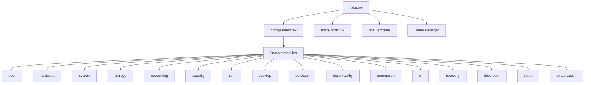

# Architecture Audit

> **Architectural conformance audit for the ivali NixOS infrastructure.**
>
> This document records the observed architecture, architectural invariants,
> dependency relationships, ownership boundaries, violations, exceptions,
> architectural debt, and migration priorities.
>
> This document is an **audit of the architecture**, not the architecture
> itself.
>
> `ARCHITECTURE.md` defines the intended architecture.
>
> `ARCHITECTURE_AUDIT.md` determines how closely the current repository
> conforms to that architecture.
>
> Machine-enforceable rules belong under `architecture/` and are enforced by
> architecture tests, the architecture linter, CI, and the `ivali`
> verification workflow.

---

# Table of Contents

1. [Audit Purpose](#1-audit-purpose)
2. [Audit Scope](#2-audit-scope)
3. [Authority and Evidence](#3-authority-and-evidence)
4. [Current Repository Inventory](#4-current-repository-inventory)
5. [Current Architectural Model](#5-current-architectural-model)
6. [Host Composition Audit](#6-host-composition-audit)
7. [Domain Inventory](#7-domain-inventory)
8. [Nix Architecture Audit](#8-nix-architecture-audit)
9. [Go Control Plane Audit](#9-go-control-plane-audit)
10. [Runtime Service Audit](#10-runtime-service-audit)
11. [Dependency Graph Audit](#11-dependency-graph-audit)
12. [State Ownership Audit](#12-state-ownership-audit)
13. [Filesystem Ownership Audit](#13-filesystem-ownership-audit)
14. [Configuration Ownership Audit](#14-configuration-ownership-audit)
15. [Secret Ownership Audit](#15-secret-ownership-audit)
16. [Network and Port Ownership Audit](#16-network-and-port-ownership-audit)
17. [Process and Systemd Ownership Audit](#17-process-and-systemd-ownership-audit)
18. [Observability Audit](#18-observability-audit)
19. [Security Architecture Audit](#19-security-architecture-audit)
20. [Deployment and GitOps Audit](#20-deployment-and-gitops-audit)
21. [Recovery and Rollback Audit](#21-recovery-and-rollback-audit)
22. [TDD and Test Architecture Audit](#22-tdd-and-test-architecture-audit)
23. [Architecture Enforcement Audit](#23-architecture-enforcement-audit)
24. [Violation Register](#24-violation-register)
25. [Architectural Debt](#25-architectural-debt)
26. [Ownership Resolution](#26-ownership-resolution)
27. [Target-State Gap Analysis](#27-target-state-gap-analysis)
28. [Migration Strategy](#28-migration-strategy)
29. [Verification Gates](#29-verification-gates)
30. [Audit Completion Criteria](#30-audit-completion-criteria)

---

# 1. Audit Purpose

The purpose of this audit is to determine whether the current repository
conforms to the architecture defined in `ARCHITECTURE.md`.

The audit evaluates:

* domain ownership;
* dependency direction;
* service boundaries;
* state ownership;
* filesystem ownership;
* configuration ownership;
* secret boundaries;
* process ownership;
* network ownership;
* observability;
* security;
* deployment;
* recovery;
* testing;
* architecture enforcement.

The audit does **not** redesign the architecture.

Architectural redesign belongs in `ARCHITECTURE.md`.

---

# 2. Audit Scope

The audit covers the repository's declared and executable infrastructure,
including:

```text
NixOS modules
Home Manager
host composition
Go control plane
runtime services
systemd units
shell scripts
CI/CD
GitOps
observability
security
networking
storage
recovery
architecture manifests
architecture tests
architecture linter
```

The audit must inspect the current repository rather than relying on
historical assumptions.

---

# 3. Authority and Evidence

Audit conclusions must be based on evidence.

Evidence priority:

```text
1. Current repository contents
2. Executable tests
3. Architecture manifests
4. Architecture linter results
5. Nix evaluation
6. Go compilation/tests
7. Runtime/service inspection
8. CI results
9. Documentation
10. Historical audit information
11. AI assumptions
```

Historical findings are not automatically current findings.

Every future audit should record:

```text
Audit date:
Branch:
Commit:
Nix file count:
Go file count:
Shell file count:
Systemd service count:
Architecture manifest version:
Architecture linter version:
```

---

# 4. Current Repository Inventory

## 4.1 Current Inventory

At the time of the original audit:

| Artifact         | Count |
| ---------------- | ----: |
| Nix files        |   187 |
| Go files         |   127 |
| Shell scripts    |    16 |
| Systemd services |   ~40 |

These numbers are **historical audit observations** and must be regenerated
during each subsequent audit.

They must not be treated as permanent repository facts.

---

# 5. Current Architectural Model

The current repository already follows a domain-oriented model.

The architectural target is:

```text
                         HOST COMPOSITION
                               │
                               ▼
                     ┌───────────────────┐
                     │      DOMAINS      │
                     └─────────┬─────────┘
                               │
             ┌─────────────────┼─────────────────┐
             ▼                 ▼                 ▼
          Platform         Functional         Runtime
          Domains           Domains           Services
             │                 │                 │
             └─────────────────┼─────────────────┘
                               ▼
                     SERVICE CONTRACTS
                               │
                               ▼
                    INFRASTRUCTURE ADAPTERS
                               │
                               ▼
                    OPERATING SYSTEM / NIX
```

The repository must preserve the following architectural invariant:

> **Hosts compose capabilities. Domains own capabilities. Services expose
> contracts. Infrastructure adapters implement those contracts.**

---

# 6. Host Composition Audit

## 6.1 Observed Model

The repository uses host specifications and a laptop-oriented host template.

Observed structure:

```text
flake.nix
    │
    ├── configuration.nix
    │
    ├── hosts/hosts.nix
    │       ├── prague.nix
    │       ├── tuscany.nix
    │       └── testvm.nix
    │
    ├── lib/host-templates/
    │       └── laptop.nix
    │
    └── home/ivali.nix
```

Host specifications are primarily data:

```nix
{
  hostName = "prague";
  userName = "ivali";

  features = {
    secrets = true;
    gitlabRunner = true;
  };

  config = {
    ivali.desktop.gnome.enable = true;
    fleet.gitopsReconciler.enable = true;
    fleet.deploymentHealth.enable = true;
  };
}
```

---

## 6.2 Architectural Assessment

### Desired invariant

```text
Host → Domain

Domain → Host
```

must be avoided.

Hosts should compose domains rather than implement domain behavior.

### Status

**Conforming, subject to continued enforcement.**

### Required architecture test

An architecture test should verify that domain modules do not import or
depend directly on individual host definitions.

---

# 7. Domain Inventory

The following inventory reflects the repository observed during the original
audit.

| Domain         | Path              | Approx. Files | State                                   | Timers / Services       |
| -------------- | ----------------- | ------------: | --------------------------------------- | ----------------------- |
| boot           | `boot/`           |             7 | —                                       | —                       |
| hardware       | `hardware/`       |             2 | —                                       | —                       |
| desktop        | `desktop/`        |            11 | —                                       | —                       |
| home           | `home/`           |           40+ | —                                       | —                       |
| networking     | `networking/`     |             3 | —                                       | —                       |
| security       | `security/`       |            11 | security scanner, Tailscale metrics     | security scan           |
| services       | `services/`       |            12 | —                                       | —                       |
| observability  | `observability/`  |            17 | Prometheus, Loki, Grafana, health state | exporters/observability |
| automation     | `automation/`     |             5 | GitOps                                  | reconciler/channel bump |
| ci             | `ci/`             |             3 | runner health                           | runner services         |
| recovery       | `recovery/`       |             4 | deployment health                       | health/backup           |
| ssh            | `ssh/`            |             4 | —                                       | —                       |
| storage        | `storage/`        |             3 | —                                       | —                       |
| system         | `system/`         |             4 | —                                       | —                       |
| developer      | `developer/`      |            14 | —                                       | —                       |
| i18n           | `i18n/`           |             2 | —                                       | —                       |
| cloud          | `cloud/`          |             2 | —                                       | —                       |
| caching        | `caching/`        |             1 | —                                       | —                       |
| cache          | `cache/`          |             1 | Attic                                   | —                       |
| virtualization | `virtualization/` |             2 | —                                       | —                       |
| theme          | `theme/gruvbox/`  |             9 | —                                       | —                       |

### Audit requirement

This table must eventually be generated or validated against
`architecture/domains.yaml`.

A manually maintained domain list will eventually drift.

---

# 8. Nix Architecture Audit

## 8.1 Module Composition

Observed architecture:

```text
flake.nix
    │
    ▼
configuration.nix
    │
    ├── auto-import mechanism
    │
    ├── desktop
    ├── package composition
    └── domain modules
```

The repository uses automatic discovery for many domain modules.

This provides low-friction composition but introduces an architectural risk:

> A newly created `.nix` file can become part of the system without an
> explicit architectural declaration.

---

## 8.2 Auto-Discovery Assessment

Auto-discovery is acceptable only if it remains subordinate to architecture
governance.

Required invariant:

```text
Auto-discovery
      +
Domain manifest
      +
Architecture tests
      =
Controlled composition
```

Auto-discovery must not become an implicit authorization mechanism for new
domains.

### Required enforcement

Architecture validation should detect:

* unknown top-level domains;
* files outside declared ownership;
* modules importing forbidden domains;
* undeclared domain dependencies.

---

# 9. Go Control Plane Audit

The Go control plane provides runtime operational functionality.

Its architecture should converge toward:

```text
cmd/
  │
  ▼
application / command layer
  │
  ▼
domain orchestration
  │
  ▼
service interfaces
  │
  ▼
infrastructure adapters
```

The audit must identify whether Go packages:

* directly invoke unrelated shell scripts;
* directly access another domain's state;
* embed infrastructure addresses;
* embed hostnames;
* duplicate Nix configuration;
* duplicate health logic;
* duplicate notification logic.

These become architecture findings when observed.

---

# 10. Runtime Service Audit

Observed runtime services include:

```text
gitops-reconciler
ci-deploy
gitlab-runner-health
gitlab-runner-reconcile
deployment-health
rollback-on-failure
prometheus
grafana
loki
alertmanager
```

The audit must classify each service by:

```text
Owner
Purpose
State
Configuration
Inputs
Outputs
Dependencies
Privileges
Network exposure
Health check
Recovery strategy
```

Example:

```text
gitops-reconciler
    │
    ├── Owner: automation/GitOps
    ├── State: /var/lib/gitops
    ├── Lifecycle: systemd
    ├── Health: deployment health
    ├── Recovery: rollback
    └── Consumers: controlled contracts
```

---

# 11. Dependency Graph Audit

## 11.1 Nix Dependency Graph

The historical graph is:



The graph must be regenerated from the repository during each audit.

---

## 11.2 Circular Dependency Assessment

### Historical result

**No circular Nix dependency was identified.**

### Required invariant

```text
Domain dependency graph = Directed Acyclic Graph
```

unless a documented architecture exception exists.

### Enforcement

Circular dependency detection must be part of architecture CI.

---

# 12. State Ownership Audit

The target architecture requires:

> **One state path → one owner.**

Historical state inventory:

| State Path                      | Current Owner                | StateDirectory | Consumers   | Assessment        |
| ------------------------------- | ---------------------------- | -------------- | ----------- | ----------------- |
| `/var/lib/valkey`               | services/redis               | Yes            | service     | Conforming        |
| `/var/lib/security-scanner`     | security                     | Yes            | Prometheus  | Conforming        |
| `/var/lib/deployment-health`    | recovery                     | Yes            | service     | Conforming        |
| `/var/lib/observability`        | observability                | Yes            | CLI         | Review boundary   |
| `/var/lib/health-endpoint`      | observability                | Yes            | endpoint    | Conforming        |
| `/var/lib/prometheus`           | observability                | Yes            | Prometheus  | Conforming        |
| `/var/lib/loki`                 | observability                | Yes            | Loki        | Conforming        |
| `/var/lib/attic`                | cache                        | Yes            | Attic       | Conforming        |
| `/var/lib/gitlab-runner-health` | ci                           | Yes            | CI          | Conforming        |
| `/var/lib/tailscale-metrics`    | security                     | No             | Prometheus  | **Violation**     |
| `/var/lib/gitops`               | unresolved at original audit | No             | CI/recovery | **High priority** |

---

# 13. Filesystem Ownership Audit

Historical findings:

| ID | Consumer                      | Path                | Expected Owner | Assessment                      |
| -- | ----------------------------- | ------------------- | -------------- | ------------------------------- |
| F1 | GitLab runner                 | `/var/lib/gitops`   | GitOps         | **Violation**                   |
| F2 | Deployment health             | `/var/lib/gitops`   | GitOps         | Contract required               |
| F3 | deployment-health script      | `/var/lib/gitops`   | GitOps         | Contract required               |
| F4 | runner-health script          | `/var/lib/gitops`   | GitOps         | Contract required               |
| F5 | observability                 | notification script | Notification   | Boundary review                 |
| F6 | `internal/commands/status.go` | observability state | Observability  | Explicit read contract required |

The important distinction is:

> **Reading another domain's state is still a dependency.**

Read-only access is not automatically architecturally valid.

---

# 14. Configuration Ownership Audit

Historical findings included:

| ID | Configuration                 | Locations                    | Assessment          |
| -- | ----------------------------- | ---------------------------- | ------------------- |
| D1 | Loki CPU quota                | multiple observability files | **Conflict**        |
| D2 | Prometheus resource limits    | multiple files               | Duplicate           |
| D3 | Node exporter resource limits | multiple files               | Duplicate           |
| D4 | Tailscale SSH firewall port   | security + SSH               | Duplicate ownership |
| D5 | Nix substituters              | system + caching + cache     | Duplicate           |
| D6 | `allowUnfree`                 | system + developer           | Duplicate           |
| D7 | package declarations          | package/domain modules       | Ownership ambiguity |

### Architectural rule

The correct response to duplicated configuration is not simply to choose the
value that currently works.

The migration must first establish:

```text
Who owns this configuration?
```

Then:

```text
Owner → authoritative configuration
Consumers → reference owner
```

---

# 15. Secret Ownership Audit

Secrets are required to follow:

```text
SOPS/age
    │
    ▼
Authorized runtime consumer
```

The audit must search for:

* plaintext secrets;
* credentials in Nix;
* credentials in Go;
* credentials in shell;
* credentials in CI configuration;
* credentials in logs;
* duplicated secret material.

Historical SOPS references were observed in CI/recovery/host composition.

### Required invariant

No domain may create an alternate secret-management mechanism.

---

# 16. Network and Port Ownership Audit

The historical audit identified split ownership of SSH port 22 on
`tailscale0`.

| ID | Resource              | Owners         | Assessment              |
| -- | --------------------- | -------------- | ----------------------- |
| N1 | SSH/Tailscale port 22 | security + SSH | **Duplicate ownership** |

### Required target

```text
SSH service
     │
     ▼
SSH domain owns service port semantics

Security/networking
     │
     ▼
Firewall policy
```

The same rule must not be independently declared by both domains.

---

# 17. Process and Systemd Ownership Audit

Every persistent systemd service must have:

```text
Owner
Description
Configuration source
State
Dependencies
Privileges
Sandboxing
Restart policy
Health model
Recovery model
Logs
```

The audit should specifically detect services that:

* create unmanaged state directories;
* depend on undocumented binaries;
* call arbitrary scripts;
* write outside declared state directories;
* run with unnecessary privileges;
* have no meaningful failure handling.

---

# 18. Observability Audit

The repository contains:

```text
Prometheus
Grafana
Loki
Alertmanager
exporters
health endpoints
observability state
```

The target architecture requires observability to remain a **consumer of
system information**, not the owner of the state being observed.

Historical issue:

```text
internal/commands/status.go
        │
        ▼
/var/lib/observability/state.json
```

This is acceptable only if the read is represented as an explicit
observability contract.

Preferred:

```text
status command
      │
      ▼
ObservabilityService / MetricsProvider
      │
      ▼
observability state
```

---

# 19. Security Architecture Audit

The audit must evaluate:

* SOPS/age;
* AppArmor;
* firewall;
* fail2ban;
* sudo;
* SSH;
* Tailscale;
* systemd hardening;
* secret exposure;
* filesystem permissions;
* service privileges.

Security violations are high priority unless explicitly excepted.

Security controls must not be duplicated between unrelated domains.

---

# 20. Deployment and GitOps Audit

The intended deployment architecture is:

```text
Git change
    │
    ▼
TDD
    │
    ▼
Verification
    │
    ▼
MR / CI
    │
    ▼
Merge
    │
    ▼
GitOps reconciliation
    │
    ▼
Generation switch
    │
    ▼
Health validation
    │
    ├── healthy → accepted
    │
    └── unhealthy → recovery / rollback
```

The audit must verify that no component bypasses this lifecycle.

Historical dependencies involving:

```text
fleet.gitops
fleet.gitlabRunner
deployment-health
ci-notify
```

must be represented in the architecture manifest or removed.

---

# 21. Recovery and Rollback Audit

Recovery currently includes:

```text
deployment health
rollback
restic backup
```

The architecture requires recovery to be independently understandable and
observable.

Audit questions:

* Can deployment health determine whether a deployment succeeded?
* Can rollback operate without relying on the failed deployment component?
* Is backup state independently owned?
* Are backup failures observable?
* Can recovery be tested?
* Is rollback behavior covered by regression tests?

---

# 22. TDD and Test Architecture Audit

This is a new mandatory dimension of architectural conformance.

The audit must evaluate whether behavior-changing changes follow:

```text
RED
 ↓
GREEN
 ↓
REFACTOR
```

## Required evidence

For new behavior:

```text
test introduced
   ↓
test fails for expected reason
   ↓
implementation added
   ↓
test passes
```

For bug fixes:

```text
reproduce defect
   ↓
regression test
   ↓
RED
   ↓
fix
   ↓
GREEN
```

### Architecture tests

Architecture rules themselves must have executable tests where practical.

Examples:

* forbidden dependency;
* forbidden filesystem access;
* duplicate ownership;
* circular dependency;
* expired exception;
* undeclared domain.

---

# 23. Architecture Enforcement Audit

The architecture enforcement system should contain:

```text
architecture/
├── domains.yaml
├── dependencies.yaml
└── exceptions.yaml
```

plus:

```text
internal/architecture/
```

and CI integration.

The architecture linter must eventually enforce at least:

```text
1. Domain validity
2. Dependency direction
3. Cycle detection
4. Filesystem ownership
5. Configuration ownership
6. Exception validity
7. Forbidden cross-domain access
8. Duplicate ownership
9. Undeclared dependencies
10. Host/domain boundary
```

---

# 24. Violation Register

The following findings originate from the historical repository audit and
must be revalidated against the current repository before remediation.

## 24.1 Cross-Domain Dependencies

| ID | Source                           | Target    | Mechanism   | Severity | Target                      |
| -- | -------------------------------- | --------- | ----------- | -------- | --------------------------- |
| C1 | `services/ci-notify.nix`         | CI option | option read | Medium   | explicit contract/ownership |
| C2 | `recovery/deployment-health.nix` | GitOps    | option read | Medium   | service contract            |
| C3 | `ci/gitlab-runner.nix`           | GitOps    | option read | Medium   | service contract            |

---

## 24.2 Filesystem Violations

| ID | Consumer                 | Path                        | Owner         | Severity |
| -- | ------------------------ | --------------------------- | ------------- | -------- |
| F1 | GitLab runner            | `/var/lib/gitops`           | GitOps        | High     |
| F2 | deployment health        | `/var/lib/gitops`           | GitOps        | Medium   |
| F3 | deployment-health script | `/var/lib/gitops`           | GitOps        | Medium   |
| F4 | runner-health script     | `/var/lib/gitops`           | GitOps        | Medium   |
| F5 | observability            | notification implementation | Notification  | Medium   |
| F6 | status command           | observability state         | Observability | Medium   |

---

## 24.3 Duplicate Configuration

| ID | Resource               | Problem                  | Severity |
| -- | ---------------------- | ------------------------ | -------- |
| D1 | Loki CPU quota         | conflicting declarations | High     |
| D2 | Prometheus limits      | duplicate declarations   | Medium   |
| D3 | Node exporter limits   | duplicate declarations   | Medium   |
| D4 | Tailscale SSH firewall | split ownership          | Medium   |
| D5 | Nix substituters       | multiple owners          | Low      |
| D6 | `allowUnfree`          | duplicate configuration  | Low      |
| D7 | packages               | unclear ownership        | Low      |

---

## 24.4 Undeclared Dependencies

Historical findings:

| ID | Component              | Dependency                | Severity |
| -- | ---------------------- | ------------------------- | -------- |
| U1 | `gitops-reconcile.sh`  | `ivali`                   | Medium   |
| U2 | `rollback.sh`          | `ivali`                   | Medium   |
| U3 | `deployment-health.sh` | service units             | Medium   |
| U4 | `notify.sh`            | mail transport            | Low      |
| U5 | runner reconciliation  | `flock`, runner           | Low      |
| U6 | `ci-notify.nix`        | external environment file | Medium   |

The correct remediation is to make dependencies explicit rather than
necessarily eliminating every dependency.

---

## 24.5 Hardcoded Host Configuration

Historical findings:

| ID | Location              | Finding            | Target                            |
| -- | --------------------- | ------------------ | --------------------------------- |
| H1 | `gitops-reconcile.sh` | `HOST="prague"`    | declared host context             |
| H2 | `rollback.sh`         | `HOST="prague"`    | declared host context             |
| H3 | runner reconcile      | `HOST="prague"`    | declared host context             |
| H4 | `ci-deploy.sh`        | default hostname   | fail when required context absent |
| H5 | runner tags           | hardcoded `prague` | generated host metadata           |

### Architectural principle

Host-specific data belongs to host composition.

It should not be embedded in reusable runtime logic.

---

# 25. Architectural Debt

Architectural debt is classified by impact.

## Critical

A violation that can:

* expose secrets;
* bypass security boundaries;
* corrupt state;
* cause unsafe deployment;
* prevent reliable recovery.

---

## High

A violation involving:

* conflicting configuration;
* unclear ownership of persistent state;
* unsafe cross-domain mutation;
* uncontrolled deployment behavior;
* significant service coupling.

---

## Medium

A violation involving:

* undocumented dependencies;
* duplicated configuration;
* contract bypass;
* cross-domain reads;
* host coupling.

---

## Low

A violation involving:

* cosmetic duplication;
* minor structural inconsistencies;
* maintainability issues with limited runtime impact.

---

# 26. Ownership Resolution

## `/var/lib/gitops`

Historical audit state:

```text
CI creates/manages
Recovery reads
GitOps reconciler uses
```

This is an ownership conflict.

### Target ownership

```text
automation / GitOps
        │
        ▼
/var/lib/gitops
```

The GitOps service becomes the authoritative owner.

Other consumers must interact through an explicit contract.

### Required migration

```text
1. Define GitOps state contract.
2. Write tests.
3. Prove RED.
4. Assign StateDirectory to GitOps.
5. Migrate CI.
6. Migrate recovery.
7. Remove direct filesystem access.
8. Prove GREEN.
9. Add architecture enforcement.
```

---

# 27. Target-State Gap Analysis

The target architecture requires the following state:

| Architectural Capability    | Current State     | Target                    |
| --------------------------- | ----------------- | ------------------------- |
| Domain ownership            | Mostly present    | Machine-enforced          |
| Host composition            | Present           | Architecture-tested       |
| Service contracts           | Partially present | Complete and enforced     |
| State ownership             | Partially defined | Explicit everywhere       |
| Filesystem ownership        | Partially defined | Machine-enforced          |
| Configuration ownership     | Mixed             | Single owner              |
| Secret ownership            | SOPS-based        | Explicit and enforced     |
| Dependency graph            | Mostly acyclic    | CI-enforced               |
| Architecture exceptions     | Present/planned   | Fully enforced            |
| Architecture linter         | Partial/planned   | CI hard gate              |
| TDD                         | Being established | Mandatory                 |
| Runtime observability       | Present           | Contract-driven           |
| Recovery                    | Present           | Tested and observable     |
| GitOps                      | Present           | Contract-driven           |
| AI architecture enforcement | Documentation     | Automated where practical |

---

# 28. Migration Strategy

Migration follows the repository's TDD and architecture model.

## Phase 0 — Re-audit

Before changing code:

* [ ] Record current commit.
* [ ] Regenerate repository inventory.
* [ ] Rebuild dependency graph.
* [ ] Rebuild state inventory.
* [ ] Rebuild filesystem ownership map.
* [ ] Rebuild configuration ownership map.
* [ ] Revalidate historical findings.
* [ ] Remove findings that no longer exist.
* [ ] Add newly discovered findings.

**Do not migrate based solely on this historical document.**

---

# Phase 1 — Establish Machine-Readable Architecture

Create or validate:

```text
architecture/
├── domains.yaml
├── dependencies.yaml
└── exceptions.yaml
```

Tests must be written before the enforcement implementation.

```text
architecture fixture
        ↓
architecture test
        ↓
RED
        ↓
linter implementation
        ↓
GREEN
```

---

# Phase 2 — Resolve Ownership

Prioritize:

1. `/var/lib/gitops`
2. Tailscale metrics state
3. observability state
4. firewall ownership
5. service resource ownership.

Each migration must establish the owner before changing implementation.

---

# Phase 3 — Remove Duplicate Configuration

For each duplicate:

```text
Find all declarations
        ↓
Determine authoritative owner
        ↓
Write regression/architecture test
        ↓
Remove duplicate
        ↓
Run verification
```

---

# Phase 4 — Establish Service Contracts

Prioritize:

```text
NotificationService
BackupService
MetricsProvider
HealthChecker
PlatformService
GitOps service contract
```

A service contract should be introduced only when it provides a meaningful
architectural boundary.

Do not create abstractions solely for abstraction's sake.

---

# Phase 5 — Migrate Consumers

Consumers move from:

```text
direct implementation
```

to:

```text
service contract
```

One consumer at a time.

Every migration must leave the repository in a working state.

---

# Phase 6 — Remove Legacy Implementations

Only after:

* all consumers migrate;
* tests cover the new path;
* integration verification passes;
* architecture tests pass.

Then remove the old implementation.

---

# Phase 7 — Enforce Architecture

The final state should be:

```text
Developer / AI
       │
       ▼
Architecture test
       │
       ▼
Architecture linter
       │
       ▼
CI gate
       │
       ▼
Merge
```

The architecture must become difficult to violate accidentally.

---

# 29. Verification Gates

Every architecture migration must use proportional verification.

## Required baseline

```bash
nix fmt -- --check
nix flake check --no-build
go build ./...
go test ./...
go vet ./...
golangci-lint run
```

Where applicable:

```bash
bash -n <script>
```

Architecture-specific:

```text
architecture tests
architecture linter
architecture manifest validation
```

Repository-specific:

```text
ivali verify
ivali doctor
```

Host evaluation must occur before rebuilding a live system.

---

## Verification order

```text
Format
  ↓
Architecture tests
  ↓
Architecture linter
  ↓
Go tests/build/lint
  ↓
Nix evaluation
  ↓
Integration tests
  ↓
Build
  ↓
Runtime verification
  ↓
Health verification
  ↓
Deployment
```

A successful compile does not prove architectural correctness.

---

# 30. Audit Completion Criteria

An architecture audit is complete only when:

### Inventory

* [ ] Current repository inventory has been regenerated.
* [ ] Historical findings have been revalidated.
* [ ] Current domain inventory is known.

### Ownership

* [ ] Every persistent state path has an owner.
* [ ] Every important configuration resource has an owner.
* [ ] Every runtime service has an owner.
* [ ] Every exposed port has an owner.
* [ ] Secret ownership is explicit.

### Dependencies

* [ ] Dependency graph is known.
* [ ] No undocumented circular dependencies exist.
* [ ] Cross-domain dependencies are documented.
* [ ] Forbidden dependencies are detected automatically.

### Contracts

* [ ] Service boundaries are explicit.
* [ ] Consumers use contracts where appropriate.
* [ ] Direct filesystem access is eliminated or explicitly excepted.

### Testing

* [ ] Architecture rules have executable tests.
* [ ] New architectural constraints follow TDD.
* [ ] Regression tests exist for fixed architectural defects.
* [ ] Tests cannot be bypassed merely to achieve GREEN.

### Enforcement

* [ ] `domains.yaml` is authoritative.
* [ ] `dependencies.yaml` is authoritative.
* [ ] `exceptions.yaml` is enforced.
* [ ] Architecture linter runs in CI.
* [ ] Architecture violations block merge where appropriate.

### Operations

* [ ] Deployment dependencies are explicit.
* [ ] Health checks are defined.
* [ ] Recovery paths are defined.
* [ ] Observability exists for important runtime services.

### Documentation

* [ ] `ARCHITECTURE.md` reflects the target architecture.
* [ ] `ARCHITECTURE_AUDIT.md` reflects current reality.
* [ ] `ARCHITECTURE_PROGRESS.md` tracks active migration.
* [ ] `CONTEXT_HANDOFF.md` contains current incomplete work when required.

---

# Final Architectural Assessment

The repository already possesses a strong foundation:

```text
NixOS
   +
Domain-oriented modules
   +
Host composition
   +
GitOps
   +
Go control plane
   +
Observability
   +
Security
   +
Recovery
```

The principal architectural challenge is no longer simply organizing files.

The next maturity stage is:

```text
Implicit architecture
        ↓
Documented architecture
        ↓
Machine-readable architecture
        ↓
Tested architecture
        ↓
CI-enforced architecture
        ↓
Self-protecting architecture
```

The desired end state is therefore not merely a repository that **documents**
its architecture.

It is a repository where:

> **The architecture is encoded in contracts, manifests, tests, lint rules,
> ownership boundaries, and CI gates so that incorrect architecture becomes
> difficult to introduce accidentally — including by AI agents.**

---

# Audit Operating Loop

```text
                 ┌─────────────────────┐
                 │ Inspect Repository  │
                 └──────────┬──────────┘
                            │
                            ▼
                 ┌─────────────────────┐
                 │ Build Current Model │
                 └──────────┬──────────┘
                            │
                            ▼
                 ┌─────────────────────┐
                 │ Compare to Target  │
                 │   ARCHITECTURE.md  │
                 └──────────┬──────────┘
                            │
                            ▼
                 ┌─────────────────────┐
                 │ Write Test / Fixture│
                 └──────────┬──────────┘
                            │
                            ▼
                 ┌─────────────────────┐
                 │        RED          │
                 └──────────┬──────────┘
                            │
                            ▼
                 ┌─────────────────────┐
                 │ Implement Migration │
                 └──────────┬──────────┘
                            │
                            ▼
                 ┌─────────────────────┐
                 │       GREEN         │
                 └──────────┬──────────┘
                            │
                            ▼
                 ┌─────────────────────┐
                 │ Architecture Lint  │
                 └──────────┬──────────┘
                            │
                            ▼
                 ┌─────────────────────┐
                 │ Full Verification  │
                 └──────────┬──────────┘
                            │
                            ▼
                 ┌─────────────────────┐
                 │ Update Audit        │
                 └──────────┬──────────┘
                            │
                            └──────► Repeat
```

**`ARCHITECTURE.md` defines where the repository is going.
`ARCHITECTURE_AUDIT.md` records where the repository actually is.
`ARCHITECTURE_PROGRESS.md` records how it gets from one to the other.**

